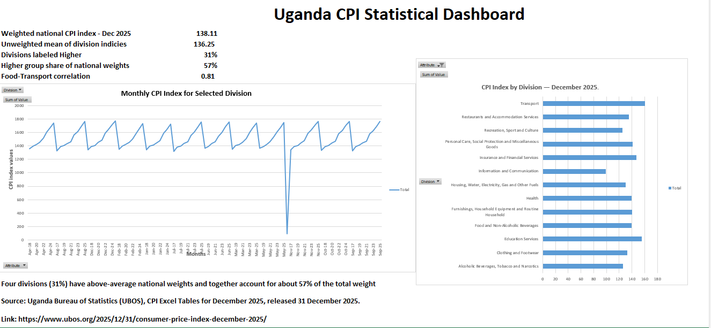

# Uganda CPI Statistical Dashboard

An Excel dashboard exploring Consumer Price Index (CPI) data for Uganda, published by the Uganda Bureau of Statistics (UBOS).

## Project overview

I prepared and analyzed the UBOS CPI data in Excel. The project uses Power Query to reshape the monthly data, PivotTables and PivotCharts to summarize it, and a dashboard to present the results.

## Excel skills used

Sorting and filtering, Excel Tables, IF, SUMIF, COUNTIF, XLOOKUP, data validation, conditional formatting, Power Query, PivotTables, and PivotCharts.

## Selected findings

- December 2025 weighted national CPI index: **138.11**
- Mean of the 13 division indices: **136.25**
- Median: **138.97**
- Standard deviation: **14.67**
- Correlation between Food and Transport monthly CPI series: **0.81**
- Four divisions (31%) were labeled “Higher,” accounting for about 57% of national weights.

The division mean is unweighted, so it differs from the weighted national CPI. Correlation describes association; it does not show cause and effect.

## Data source

Uganda Bureau of Statistics (UBOS), *CPI Excel Tables — December 2025*.  
[UBOS datasets](https://www.ubos.org/datasets/)

The workbook contains a copy of the public dataset with analysis added.
